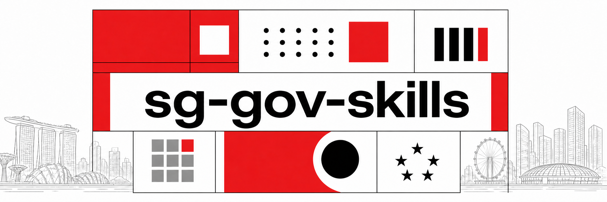

<h1 align="center">Singapore Government Agent Skills for Secure Digital Services, ICT, and Smart Systems</h1>



---

Agent skills for teams building digital services for **Singapore government agencies**. They work with Claude Code, Codex, Cursor, and any other agent the [`skills` CLI](https://github.com/vercel-labs/skills) supports, and they are not tied to a particular model.

Each skill covers one part of the government delivery stack: choosing the System Security Plan (SSP) under the ICT&SS Policy Reform (IM8's successor), implementing controls from the Cybersecurity and Digital Service Standards (DSS) control catalogs, integrating Singpass, Corppass, and Myinfo, and meeting WCAG 2.2 accessibility requirements. Skills are small and self-contained, so you can install only what you need or fork and adapt them.

There are 18 skills, each with its own eval suite. On the benchmark tasks below, loading the relevant skill raised assertion pass rates to 100%, from baselines between 22% and 83%.

## Installation

Install with the [`skills` CLI](https://github.com/vercel-labs/skills):

### Install all skills in this repo
```sh
npx skills add kyleoliveiro/sg-gov-skills
```

### Install individual skills
```
npx skills add kyleoliveiro/sg-gov-skills -s <skill-name>
```

The CLI installs into `.agents/skills/` and symlinks the skills into the agent directories you choose (Claude Code, Cursor, Codex, and others). Run interactively, the first command groups the skills the same way as the tables below.

Every skill name starts with `sg-gov-`, so the installed skills sort together and are easy to tell apart from skills from other sources.

### Upgrading from unprefixed names

Earlier versions used names without the prefix (`singpass`, `access-control`, and so on). Reinstalling adds the `sg-gov-` skills but leaves the old folders in place. Delete the old folders from `.agents/skills/` and any agent skill directories they were symlinked into (such as `.claude/skills/`), then run `npx skills add kyleoliveiro/sg-gov-skills` again.

## What these skills help you do

- Determine which Singapore government System Security Plan applies.
- Audit application code against ICT&SS security controls.
- Build secure GitHub and GitLab CI/CD pipelines.
- Harden Docker and Kubernetes workloads.
- Segment networks, lock down security groups, and secure hybrid and service-to-service connectivity.
- Deploy multi-AZ, auto-scaling systems with immutable backups, recovery testing, and DR/BC plans.
- Secure Generative AI features against the Gen-AI SSP overlay.
- Set up vulnerability scanning, VAPT, and disclosure programmes.
- Enforce data residency, encryption, DLP, and secure disposal for government data.
- Set up logging, security monitoring, and GCSOC-centralised detection.
- Govern accounts, MFA, Singpass/Corppass and SSO, and the account lifecycle.
- Integrate Singpass and Corppass login and Myinfo pre-fill, and migrate legacy integrations.
- Build DSS-compliant transaction and payment flows: multi-step forms, save-draft, pre-fill, payments, receipts, and status tracking.
- Meet WCAG 2.2 and Digital Service Standards accessibility requirements.
- Build an SGDS-compliant Singapore government service shell.

## Who these skills are for

Engineers, tech leads, security reviewers, and accessibility specialists at GovTech, OGP, and other agencies, and vendors who build for them. They are also useful when preparing for an architecture review, security assessment, accessibility audit, or production readiness check.

## Skills

The official [Control Catalog](https://info.standards.tech.gov.sg/control-catalog/) has two catalogs: [Cybersecurity](https://info.standards.tech.gov.sg/control-catalog/cybersecurity/) and [Digital Service Standards](https://info.standards.tech.gov.sg/control-catalog/dss/). The skills below are grouped by the catalog and control domains they implement. The SSP navigator, which spans both catalogs, and the national digital identity integrations have their own groups.

### System Security Plan

| Skill | Catalog scope | Description |
| ----- | ------------- | ----------- |
| **System Security Plan Navigator**<br>[sg-gov-ssp-navigator](skills/sg-gov-ssp-navigator/) | [Cybersecurity](https://info.standards.tech.gov.sg/control-catalog/cybersecurity/) and [DSS](https://info.standards.tech.gov.sg/control-catalog/dss/) profiles | Determine which System Security Plan(s) apply under the ICT&SS Policy Reform (IM8's successor), including the Gen-AI overlay and DSS profiles, and emit the Level 0/1/2 control baseline and lifecycle steps. |

### Cybersecurity

| Skill | Control domain(s) | Description |
| ----- | ----------------- | ----------- |
| **Secure Application Coding**<br>[sg-gov-secure-coding-as](skills/sg-gov-secure-coding-as/) | [Application Security (AS)](https://info.standards.tech.gov.sg/control-catalog/cybersecurity/as/); [Cryptography, Encryption and Key Management (CK)](https://info.standards.tech.gov.sg/control-catalog/cybersecurity/ck/) | Write and review application code against AS-1..15 and CK-1..4: input validation, parameterised queries, password hashing, secrets, CSP/HSTS, uploads, and error hygiene. |
| **Secure CI/CD Pipeline**<br>[sg-gov-secure-pipeline](skills/sg-gov-secure-pipeline/) | [Secure Development (SD)](https://info.standards.tech.gov.sg/control-catalog/cybersecurity/sd/); [Software Supply Chain (SC)](https://info.standards.tech.gov.sg/control-catalog/cybersecurity/sc/) | Set up or audit repos and CI/CD against SD-1..10 and SC-1..9, with GitHub/GitLab recipes and open-source fallbacks. |
| **Container Security**<br>[sg-gov-container-security](skills/sg-gov-container-security/) | [Container Security (CS)](https://info.standards.tech.gov.sg/control-catalog/cybersecurity/cs/) | Build, scan, and run containers against CS-1..11: digest-pinned minimal base images, non-root users, runtime secrets, read-only root filesystems, image scanning, private registries, and Kubernetes runtime hardening. |
| **Gen-AI Security**<br>[sg-gov-gen-ai-security](skills/sg-gov-gen-ai-security/) | [Generative AI (GA)](https://info.standards.tech.gov.sg/control-catalog/cybersecurity/ga/); [Data Protection (DP-8)](https://info.standards.tech.gov.sg/control-catalog/cybersecurity/dp/#dp-8-data-classification-disclosure) | Build or audit GenAI features against the Gen-AI SSP overlay (GA-1..8 + DP-8): data-classification routing, provider agreements, approved model formats and loaders, file-upload safeguards, output evaluation, and hallucination acknowledgement. |
| **VAPT & Security Testing**<br>[sg-gov-security-testing](skills/sg-gov-security-testing/) | [Security Testing (ST)](https://info.standards.tech.gov.sg/control-catalog/cybersecurity/st/) | Set up or audit the security testing programme against ST-1..5: host vulnerability assessment scans, cloud security posture management, an RFC 9116 security.txt disclosure channel, VAPT, and severity-based remediation SLAs. |
| **Data Protection**<br>[sg-gov-data-protection](skills/sg-gov-data-protection/) | [Data Protection (DP)](https://info.standards.tech.gov.sg/control-catalog/cybersecurity/dp/) | Build or audit data handling against DP-1..8: Singapore data residency, encryption at rest and in transit, central cloud tenancy, storage sanitisation and destruction, DLP, and classification disclosure at input fields. |
| **Logging & Monitoring**<br>[sg-gov-logging-monitoring](skills/sg-gov-logging-monitoring/) | [Logging and Monitoring (LM)](https://info.standards.tech.gov.sg/control-catalog/cybersecurity/lm/) | Set up or audit logging and monitoring against LM-1..21: security log coverage, tamper-resistant storage, retention and sanitisation, central security log management with GCSOC, detection, and operational monitoring. |
| **Access Control**<br>[sg-gov-access-control](skills/sg-gov-access-control/) | [Access Control (AC)](https://info.standards.tech.gov.sg/control-catalog/cybersecurity/ac/) | Set up or audit identity and access management against AC-1..16: least privilege, MFA, Singpass/Corppass vs government SSO, account lifecycle and reviews, credential rotation, endpoint hardening, and device-based access. |
| **Network Security**<br>[sg-gov-network-security](skills/sg-gov-network-security/) | [Network Security (NS)](https://info.standards.tech.gov.sg/control-catalog/cybersecurity/ns/) | Design or audit network boundaries against NS-1..11: tiered VPC segmentation, deny-by-default rules, private inter-network and hybrid connectivity, WAF/DDoS/CDN edge filtering, valid TLS certificates, mTLS service-to-service traffic, IPS/IDS, remote-access hardening, and firewall-change alerts. |
| **Resiliency & Recovery**<br>[sg-gov-resiliency-recovery](skills/sg-gov-resiliency-recovery/) | [Resiliency (RS)](https://info.standards.tech.gov.sg/control-catalog/cybersecurity/rs/); [Backup and Recovery (BR)](https://info.standards.tech.gov.sg/control-catalog/cybersecurity/br/) | Build or audit availability and recoverability against RS-1..3 and BR-1..6: multi-AZ deployment, auto-scaling, load testing, encrypted separate-location backups with immutable retention, recovery testing against RTO/RPO, and the DR plan, BCP, and continuity exercises. |

### Digital Service Standards

| Skill | Control domain(s) | Description |
| ----- | ----------------- | ----------- |
| **Digital Service Standards Accessibility**<br>[sg-gov-dss-accessibility](skills/sg-gov-dss-accessibility/) | WCAG: [Perceivable (WP)](https://info.standards.tech.gov.sg/control-catalog/dss/wp/), [Operable (WO)](https://info.standards.tech.gov.sg/control-catalog/dss/wo/), [Understandable (WU)](https://info.standards.tech.gov.sg/control-catalog/dss/wu/), [Robust (WR)](https://info.standards.tech.gov.sg/control-catalog/dss/wr/) | Build and review frontend code against the 53 WCAG-2.2-derived DSS accessibility controls, with Digital Services (Others) vs Digital Services (High Impact) levels and a testing workflow. |
| **Singapore Government Service Shell**<br>[sg-gov-service-shell](skills/sg-gov-service-shell/) | [Trust and Legitimacy (TL)](https://info.standards.tech.gov.sg/control-catalog/dss/tl/); [Baseline Design Practices (BD)](https://info.standards.tech.gov.sg/control-catalog/dss/bd/); [Performance and Reliability (PR)](https://info.standards.tech.gov.sg/control-catalog/dss/pr/) | Build the common shell for a government digital service: Official Government Banner, WOGAA, official footer, .gov.sg domain, SGDS setup, and the rest of the TL, BD, and PR controls. |
| **Transactions & Payments**<br>[sg-gov-transactions-payments](skills/sg-gov-transactions-payments/) | [Transactions and Payments (TX)](https://info.standards.tech.gov.sg/control-catalog/dss/tx/) | Build or audit transaction and payment flows against TX-1..15: digital-first journeys, upfront prerequisites and fees, multi-step forms with progress and save-draft, Myinfo/EDH pre-fill, payment and refund transparency, stored-payment management, outcome messaging, receipts, and status notifications and tracking. |

### National Digital Identity

These skills cover Singpass, Myinfo, and Corppass integration and migration. They support Cybersecurity control AC-7, but they are organised around the product APIs, onboarding, data use, and migration rather than a control family.

| Skill | Area | Description |
| ----- | ---- | ----------- |
| **Singpass**<br>[sg-gov-singpass](skills/sg-gov-singpass/) | Digital identity integration | Integrate citizen/resident login and Myinfo (v5) verified person-data pre-fill on the current FAPI 2.0 Singpass API: PAR/PKCE/DPoP, UUID-first identity, Myinfo scopes, onboarding, and app-review rules. |
| **Corppass**<br>[sg-gov-corppass](skills/sg-gov-corppass/) | Digital identity integration | Integrate business-user login and Myinfo Business corporate-data pre-fill via the Corppass Authorization API (FAPI 2.0): entity and user identity, roles, third-party authorisation, onboarding, and provisioning. |
| **Singpass (legacy)**<br>[sg-gov-singpass-legacy](skills/sg-gov-singpass-legacy/) | Legacy integration migration | Maintain, debug, or migrate Myinfo v3/v4 and pre-FAPI Singpass integrations, including their wire formats and mandatory migration deadlines. |
| **Corppass (legacy)**<br>[sg-gov-corppass-legacy](skills/sg-gov-corppass-legacy/) | Legacy integration migration | Maintain or migrate pre-FAPI 2.0 Corppass and Myinfo Business v1/v2 integrations, including claim mapping, identity-model changes, and migration deadlines. |

### Not covered

Four control domains are out of scope because delivery teams cannot meet them in code: [Datacentre (DC)](https://info.standards.tech.gov.sg/control-catalog/cybersecurity/dc/) is physical facility security, inherited from the CSP or datacentre operator; [Human Resource (HR)](https://info.standards.tech.gov.sg/control-catalog/cybersecurity/hr/) is personnel governance; [Security Programme Management (PM)](https://info.standards.tech.gov.sg/control-catalog/cybersecurity/pm/) is agency governance, although [sg-gov-ssp-navigator](skills/sg-gov-ssp-navigator/) covers its SSP selection, tailoring, and submission workflow; and the DSS [Understand Users (UU)](https://info.standards.tech.gov.sg/control-catalog/dss/uu/) family is user research practice.

Each skill lives in [`skills/`](skills/) as a folder with a `SKILL.md` entry point.

## Benchmarks

Every skill ships with an eval suite under `skills/<skill>/evals/`. Each eval is a delivery task, such as scaffolding a portal shell, auditing a seeded service, or building authenticated endpoints, graded against objective assertions such as "every input has a programmatic label" or "secrets are read from the environment, never hardcoded". Each task runs on the same model with and without the skill, and the score is the fraction of assertions met.

> **Benchmark refresh pending:** the Cybersecurity skills now have a third holdout scenario and separate description-trigger datasets. The results below cover only the scenarios listed in the per-scenario breakdown; the holdouts will be added once they have been run three times like the others. [sg-gov-network-security](skills/sg-gov-network-security/), [sg-gov-transactions-payments](skills/sg-gov-transactions-payments/), and [sg-gov-resiliency-recovery](skills/sg-gov-resiliency-recovery/) have eval suites but have not been benchmarked yet, so they are not in the table.

| Skill | Scenarios | Assertions | With skill | Without skill | Lift |
| ----- | :-------: | :--------: | :--------: | :-----------: | :--: |
| [sg-gov-ssp-navigator](skills/sg-gov-ssp-navigator/) | 2 | 18 | **100%** | 22% | +78 pts |
| [sg-gov-secure-coding-as](skills/sg-gov-secure-coding-as/) | 2 | 19 | **100%** | 70% | +30 pts |
| [sg-gov-secure-pipeline](skills/sg-gov-secure-pipeline/) | 2 | 21 | **100%** | 68% | +32 pts |
| [sg-gov-container-security](skills/sg-gov-container-security/) | 2 | 21 | **100%** | 73% | +27 pts |
| [sg-gov-gen-ai-security](skills/sg-gov-gen-ai-security/) | 2 | 22 | **100%** | 47% | +53 pts |
| [sg-gov-security-testing](skills/sg-gov-security-testing/) | 2 | 22 | **100%** | 78% | +22 pts |
| [sg-gov-data-protection](skills/sg-gov-data-protection/) | 2 | 22 | **100%** | 61% | +39 pts |
| [sg-gov-logging-monitoring](skills/sg-gov-logging-monitoring/) | 2 | 22 | **100%** | 74% | +26 pts |
| [sg-gov-access-control](skills/sg-gov-access-control/) | 2 | 23 | **100%** | 69% | +31 pts |
| [sg-gov-singpass](skills/sg-gov-singpass/) | 2 | 23 | **100%** | 45% | +56 pts |
| [sg-gov-corppass](skills/sg-gov-corppass/) | 2 | 22 | **100%** | 51% | +49 pts |
| [sg-gov-corppass-legacy](skills/sg-gov-corppass-legacy/) | 2 | 22 | **100%** | 60% | +40 pts |
| [sg-gov-singpass-legacy](skills/sg-gov-singpass-legacy/) | 2 | 22 | **100%** | 62% | +38 pts |
| [sg-gov-dss-accessibility](skills/sg-gov-dss-accessibility/) | 3 | 27 | **100%** | 83% | +17 pts |
| [sg-gov-service-shell](skills/sg-gov-service-shell/) | 2 | 19 | **100%** | 36% | +64 pts |

The gains are largest where a model cannot infer the requirement without knowing the policy, such as which System Security Plan applies, or that a public service needs the Official Government Banner and WOGAA. The Singpass and Corppass skills gain for a different reason: most of the current stack (FAPI 2.0, PAR/DPoP, Myinfo v5, `sub` identifying the entity) is newer than the models' training data. Without the skill, greenfield designs used the wrong API version or invented endpoints, and one legacy-migration baseline claimed that Myinfo v5 does not exist. Accessibility gains the least because models already apply common WCAG patterns; the skill adds control IDs, correct live-region usage, and a usable session-expiry state.

<details>
<summary>Per-scenario breakdown</summary>

| Skill | Scenario | Assertions | With skill | Without skill |
| ----- | -------- | :--------: | :--------: | :-----------: |
| sg-gov-ssp-navigator | stacked-genai-service | 10 | 100% | 20% |
| sg-gov-ssp-navigator | cii-migration-gaps | 8 | 100% | 25% |
| sg-gov-secure-coding-as | audit-seeded-service | 8 | 100% | 75% |
| sg-gov-secure-coding-as | build-auth-endpoints | 11 | 100% | 64% |
| sg-gov-secure-pipeline | audit-seeded-pipeline | 9 | 100% | 78% |
| sg-gov-secure-pipeline | setup-github-repo | 12 | 100% | 58% |
| sg-gov-container-security | audit-seeded-containers | 10 | 100% | 77% |
| sg-gov-container-security | harden-container-build | 11 | 100% | 70% |
| sg-gov-gen-ai-security | audit-seeded-genai | 12 | 100% | 67% |
| sg-gov-gen-ai-security | build-genai-feature | 10 | 100% | 27% |
| sg-gov-security-testing | audit-seeded-st-posture | 12 | 100% | 86% |
| sg-gov-security-testing | setup-st-programme | 10 | 100% | 70% |
| sg-gov-data-protection | audit-seeded-dp | 12 | 100% | 61% |
| sg-gov-data-protection | setup-dp-baseline | 10 | 100% | 60% |
| sg-gov-logging-monitoring | audit-seeded-lm | 12 | 100% | 75% |
| sg-gov-logging-monitoring | setup-lm-baseline | 10 | 100% | 73% |
| sg-gov-access-control | audit-seeded-ac | 13 | 100% | 77% |
| sg-gov-access-control | setup-ac-baseline | 10 | 100% | 60% |
| sg-gov-singpass | audit-singpass-integration | 13 | 100% | 59% |
| sg-gov-singpass | design-singpass-service | 10 | 100% | 30% |
| sg-gov-corppass | audit-corppass-integration | 12 | 100% | 74% |
| sg-gov-corppass | design-corppass-service | 10 | 100% | 27% |
| sg-gov-corppass-legacy | audit-half-migrated-corppass | 12 | 100% | 69% |
| sg-gov-corppass-legacy | plan-legacy-corppass-migration | 10 | 100% | 50% |
| sg-gov-singpass-legacy | audit-legacy-singpass-estate | 12 | 100% | 83% |
| sg-gov-singpass-legacy | plan-legacy-singpass-migration | 10 | 100% | 40% |
| sg-gov-dss-accessibility | feedback-form-build | 10 | 100% | 90% |
| sg-gov-dss-accessibility | audit-seeded-page | 8 | 100% | 75% |
| sg-gov-dss-accessibility | timeout-modal | 9 | 100% | 85% |
| sg-gov-service-shell | scaffold-portal-shell | 10 | 100% | 40% |
| sg-gov-service-shell | review-agency-homepage | 9 | 100% | 33% |

</details>

*Methodology: scores are the mean pass rate over 3 runs per configuration, from each scenario's most recent benchmark. For three skills, one eval was re-run after a fix, and the re-run is shown. "Without skill" is the same model and prompt with no skill loaded. Results vary by model, so read them as a rough indication.*

## Frequently asked questions

### What is an Agent Skill?

A folder of instructions, reference material, and optional scripts that an AI coding agent loads when a task needs it. Each skill here has a `SKILL.md` entry point and covers one Singapore government delivery concern.

### Which AI coding agents can use these skills?

Any agent the `skills` CLI supports, including Claude Code, Codex, and Cursor. The skills do not depend on a particular model.

### Can I install a single skill?

Yes. Run `npx skills add kyleoliveiro/sg-gov-skills -s <skill-name>` and replace `<skill-name>` with a folder name from the tables above.

### Do these skills guarantee compliance?

No. They help agents apply the published controls, but they do not replace your agency's governance process, security review, or System Security Plan. Check compliance-critical work against the published standards and your project's approved requirements.

### Are these official Singapore government resources?

No. This is an unofficial community project. See the [disclaimer](#disclaimer).

## Sources

Control text in these skills is transcribed from the public control catalogs and related standards at [info.standards.tech.gov.sg](https://info.standards.tech.gov.sg/), as of the date given in each skill's `SKILL.md`. The standards change, so check the live pages for anything compliance-critical. Each skill links the catalog pages it uses.

## Disclaimer

These skills are provided "as is", without warranty of any kind, express or implied, including but not limited to the warranties of merchantability, fitness for a particular purpose, and non-infringement.

This is an unofficial, community-maintained resource. It is not affiliated with, endorsed by, or published by GovTech, the Singapore Government, or any of its agencies. Nothing here is legal, security, or compliance advice, and installing a skill does not by itself make a system compliant with the ICT&SS Policy Reform, the Digital Service Standards, PDPA, or any other requirement. You are responsible for verifying every control against the authoritative source and your project's System Security Plan.

To the maximum extent permitted by law, the authors and contributors accept no liability for any claim, damages, or other loss arising from the use of this repository. See [LICENSE](LICENSE) for the full terms.

## Contributing

See [`skills/README.md`](skills/README.md) for authoring conventions. In short: one folder per skill, a kebab-case name starting with `sg-gov-`, a `SKILL.md` with `name` and `description` frontmatter, and supporting files (`references/`, `scripts/`, `assets/`) only when the skill needs them. Add every new skill to the appropriate catalog table above and installer group in [`.claude-plugin/marketplace.json`](.claude-plugin/marketplace.json).

### Repository layout

```
skills/           Published skills, one folder per skill, each with a SKILL.md and evals/
.claude-plugin/   Installer groups for the skills CLI
scripts/          Eval validation and trigger-eval runners
research/         Background notes used to write the skills
skills-lock.json  Lockfile for the authoring skills (skill-creator, humanizer)
.agents/skills/   Installed authoring skills (gitignored; restore with `npm run skills:restore`)
```

## License

[MIT](LICENSE)
